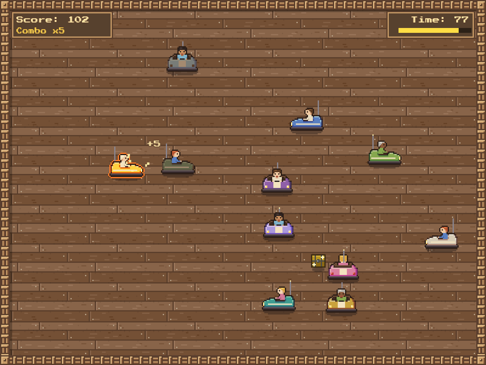
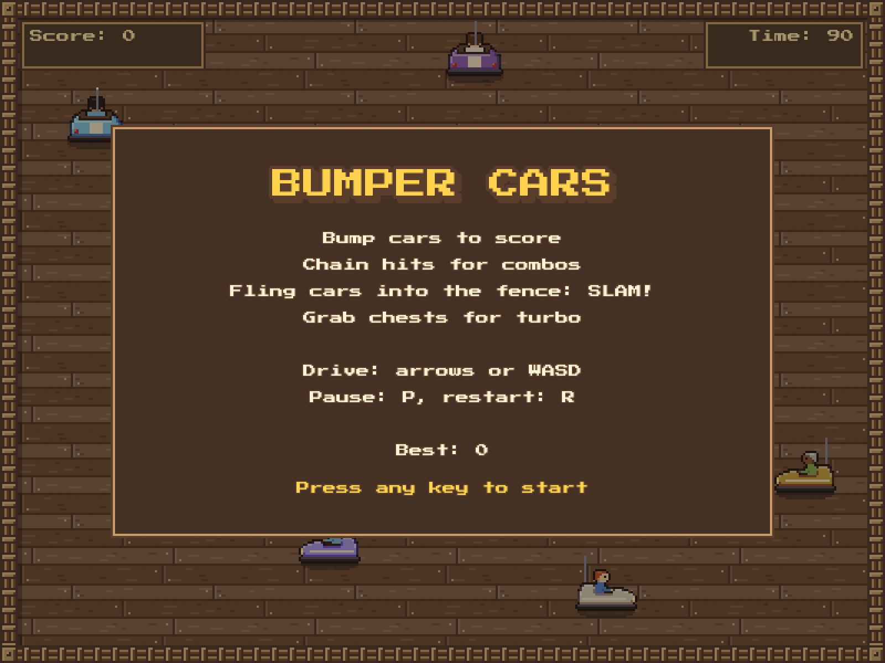
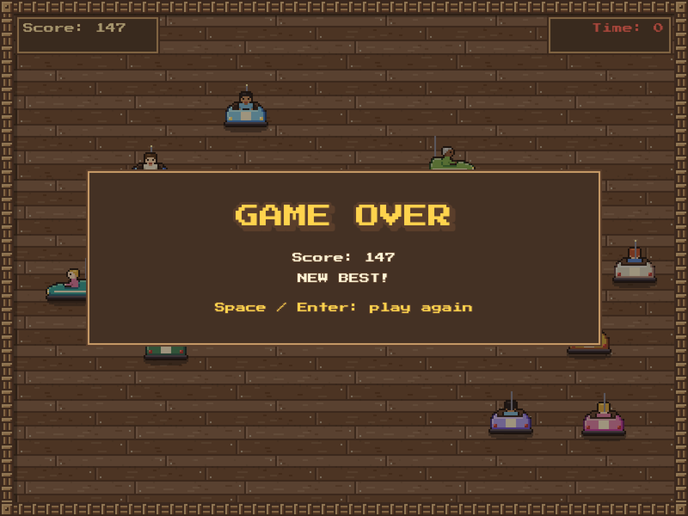

<div align="center">

# Bumper Cars

**A cozy pixel-art arcade game for the browser.**<br>
Ram the other cars, chain combos, fling them into the fence: you have 90 seconds.




</div>

## Features

- **Bumper cars with momentum.** You accelerate, drift and get knocked back. The harder you hit, the further cars fly.
- **Combos and slams.** Chain hits within 2.5 seconds for up to ×5 points, and fling a car into the fence for a slam bonus.
- **Turbo chests.** Grab the chest before it vanishes to turn gold: faster driving and harder bumps.
- **Readable at a glance.** Cars you just scored on grey out until they're worth points again, and the timer turns red for the last 10 seconds.
- **Every pixel is generated in code.** There are no image or audio files. Cars are drawn from ASCII templates, the arena from canvas calls, and sounds are synthesized with the Web Audio API.
- **Best score saved** in your browser between visits.

## How to play

| Key | Action |
| --- | --- |
| <kbd>←</kbd> <kbd>↑</kbd> <kbd>→</kbd> <kbd>↓</kbd> or <kbd>W</kbd> <kbd>A</kbd> <kbd>S</kbd> <kbd>D</kbd> | Drive |
| <kbd>P</kbd> | Pause / resume |
| <kbd>R</kbd> | Restart the round |
| <kbd>Space</kbd> / <kbd>Enter</kbd> | Start, or play again after a round |

| Move | Points |
| --- | --- |
| Drive into a car | your current combo (×1 to ×5); each car can score once every 2 s |
| Hit another car within 2.5 s | combo +1 |
| Slam: the car you just hit flies into the fence | +2 |
| Turbo chest | 5 s of extra speed and bump strength |

> [!TIP]
> Momentum is the whole game. Line up a run so you hit one car and carry on into the next, and aim your hits at the fence.

<table>
  <tr>
    <td></td>
    <td></td>
  </tr>
</table>

## Getting started

You need [Node.js](https://nodejs.org/) 22.12 or newer.

```bash
npm install
npm run dev
```

This opens the game at <http://localhost:5173>. To build a static version you can host anywhere:

```bash
npm run build
npm run preview
```

| Script | What it does |
| --- | --- |
| `npm run dev` | Dev server with hot reload |
| `npm run build` | Production build into `dist/` |
| `npm run preview` | Serve the production build |
| `npm test` | Unit tests with coverage (Vitest) |
| `npm run lint` | ESLint |

## How it's made

The game uses [Phaser 4](https://phaser.io/) with Arcade Physics, bundled by [Vite](https://vite.dev/), in plain JavaScript modules.

**Procedural pixel art.** Every car is an ASCII template painted with a per-car palette at startup. Each body colour gets a four-tone, hue-shifted ramp. The same templates also make the driving bob frame, the white hit flash, the greyed-out cooldown look and the turbo glow. Here is the front view; `b` is the body colour, `c` the stripe, `y`/`w` the headlights and `r` the rubber bumper:

```text
......oooooooooooooo......
.....oKKKKKKKKKKKKKKo.....
...ooKkkkkkkkkkkkkkKoo....
..olhkkkkkkkkkkkkkkkbso...
.olhhhhhhhhhhhhhhhhhbbslo.
.lhbbbbbbbccccccbbbbbbbsl.
.lbwybbbbbccccccbbbbbwysl.
.osssssssssssssssssssssso.
oRRRRRRRRRRRRRRRRRRRRRRRRo
orrrrrrrrrrrrrrrrrrrrrrrro
```

Art is drawn at one art pixel and shown at 2×, so cars, floor, fence and chest share one chunky pixel grid. Colour variants are baked into textures rather than tinted, so the game also looks right on Phaser's Canvas renderer.

**Game feel.** Pure, unit-tested functions handle steering, drag and bumps (`src/logic/physics.js`), and scoring and spawning (`src/logic/gameLogic.js`). All gameplay timing runs on one pausable clock.

```text
src/
├── main.js              game config, boot
├── config/constants.js  every tunable number and colour
├── logic/               pure gameplay rules (no Phaser)
├── scenes/GameScene.js  round flow, input, physics wiring, effects
├── ui/Hud.js            score, timer, panels, overlays
├── sprites/Car.js       car sprite and physics body
└── utils/               car art, textures, colours, sounds, high score
```

Working on the code, or pointing an AI coding agent at it? [`AGENTS.md`](AGENTS.md) explains the architecture, the conventions and the Phaser gotchas this project has run into.

## License

[Apache License 2.0](LICENSE)
